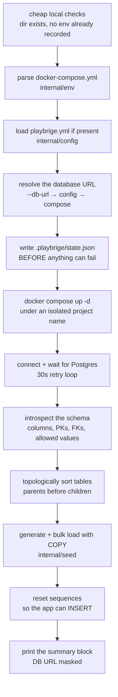

# Architecture

How Playbrige works, and why it is shaped this way. Read this before changing anything in
`internal/`.

If you only want to *use* the tool, [`README.md`](../README.md) is enough. If you want to know what
was built when and which bugs were found on the way, see
[`BUILD_SESSION_LOG.md`](BUILD_SESSION_LOG.md). The behavioural contract is
[`PLAYBRIGE_MVP_BUILD_SPEC.md`](PLAYBRIGE_MVP_BUILD_SPEC.md).

---

## The idea in one paragraph

A developer clones a Postgres-backed app they have never seen, types `playbrige up`, and about ten
seconds later has the app running against a database full of data that looks like it came from real
customers — where every foreign key points at a row that actually exists. `playbrige down` removes
the containers, networks, and volumes. Everything runs locally against the developer's own Docker and
their own `docker-compose.yml`. There is no server, no account, and no daemon.

---

## The `up` pipeline

`up` is the whole product. Everything else is a smaller slice of the same machinery.



Two orderings in that diagram are deliberate and load-bearing:

**Cheap local checks come first.** A typo in `--file`, or a forgotten `down`, fails in milliseconds
instead of after a Docker round trip. Resolving the database URL is also done up front, so a repo with
no detectable Postgres fails *before* any container is started.

**State is written before anything can fail.** `.playbrige/state.json` is the only record of which
compose project name owns these containers. `docker compose up` creates the network and volumes even
when it then fails to start a service, so writing state afterwards would strand whatever it created
and leave `down` reporting *"No environment is running"* over a live stack. This was a real bug; see
§4.6 of the session log.

---

## Package map

```
main.go                     thin: only calls cli.Execute()
internal/
  cli/      the cobra tree, the six commands, the output contract
  env/      compose parsing, the Docker CLI, the state file
  db/       connect, introspect, order
  seed/     generate and bulk load — the core
  config/   the optional playbrige.yml
testapp/    the fixture CI runs against
e2e_test.go the spec §11 definition of done (build-tagged)
```

| Package | Owns | Key entry points |
|---|---|---|
| `cli` | Command wiring, flag state, all user-visible output. Nothing else prints. | `Execute`, `NewRootCmd`, `Step`/`Resource`/`Warn`/`Failf`/`Ready` |
| `env` | The environment lifecycle: what a compose file says, what Docker is told, what we remember. | `ParseCompose`, `FindPostgres`, `PostgresURL`, `AppURL`, `NewProjectName`, `MaskURL`, `Up`/`Down`/`Logs`, `SaveState`/`LoadState`/`DeleteState` |
| `db` | Everything that talks SQL. | `Connect`, `Introspect`, `AllowedValues`, `TopoSort`, `TableNames`, `RowCounts`, `Truncate` |
| `seed` | Turning a schema into believable rows and getting them in fast. | `Seed`, `NewGenerator`, `Value`, `PKValue`, `Profile`, `Pick`, `RowCountFor` |
| `config` | Parsing an optional file and defaulting everything. | `Load`, `Default`, `RowsFor`, `DistributionFor` |

Dependencies point one way: `cli → {env, db, seed, config}`, `seed → {db, config}`, and `env`, `db`,
`config` depend on nothing internal. There are no cycles and no shared mutable state between packages.

`main.go` is deliberately trivial — it calls `cli.Execute()` and sets the exit code. Command
construction lives in `internal/cli` so it is testable without running a binary.

---

## The data model

`internal/db/model.go` is the vocabulary the rest of the code speaks.

```go
type Schema struct {
    Tables map[string]*Table  // keyed by table name
    Order  []string           // topological, parents first — filled by TopoSort
}

type Table struct {
    Name       string
    Columns    []Column
    FKs        []FK
    PrimaryKey []string       // plural: composite keys are real
}
```

`Column` carries more than the spec's four fields, and every addition exists because something
downstream would otherwise produce data Postgres rejects:

| Field | Why it exists |
|---|---|
| `DataType` | Normalised onto a canonical set (`TypeInt`, `TypeVarchar`, …) so the generator reasons about ~18 types, not every Postgres spelling |
| `UDTName` | Resolves an enum column to its type so its labels can be looked up |
| `MaxLength` | `varchar(6)` rejects a 7-character value; strings are truncated to fit |
| `NumericPrecision`, `NumericScale` | `numeric(5,2)` tops out at 999.99; money-shaped values overflowed and failed the COPY |
| `HasDefault`, `IsIdentity`, `IdentityGeneration` | `GENERATED ALWAYS AS IDENTITY` rejects a supplied value, so those columns must be left to Postgres |

### Foreign keys are grouped, not listed

A multi-column foreign key arrives from the catalog as one row *per column pair*. Stored as a flat
`[]FK` they are indistinguishable from several independent single-column keys — and drawing each
column separately produces pairs that exist in no parent row. `FK.ConstraintName` (from
`pg_constraint.conname`) plus `Table.FKGroups()` fixes that:

```go
type FKGroup struct {
    Name          string
    ParentTable   string
    ChildColumns  []string   // positionally paired
    ParentColumns []string
    Deferred      bool
}
func (g FKGroup) Composite() bool  // len(ChildColumns) > 1
func (g FKGroup) Key() string      // "parent.col1,col2" — the pool key
```

**Always work through `FKGroups()`, never the raw `FKs` slice**, when the *relationship* matters.
The raw slice is fine for counting or for asking "is this column a foreign key".

---

## Introspection (`internal/db/introspect.go`)

Four catalog reads: columns, primary keys, foreign keys, and allowed values. Two of them are written
against `pg_catalog` rather than `information_schema`, and both departures are deliberate:

**Foreign keys use `unnest(conkey, confkey)`.** The spec sketches an `information_schema` join of
`key_column_usage` to `constraint_column_usage`. That join **cross-products a multi-column foreign
key**, inventing column pairings that do not exist. `unnest` of the two arrays pairs them
positionally, which is the only correct reading. *If you ever "simplify" this back to the spec's
version, you reintroduce the bug.*

**The `pg_type` join is namespace-qualified** via `udt_schema`. Matching on `typname` alone
duplicates every column row whenever a same-named type exists in another schema.

Views are excluded by joining against `pg_tables` — they cannot be seeded. A foreign key pointing
outside the seedable set is dropped rather than recorded, because the generator would have no pool to
draw from.

### Allowed values

`AllowedValues` answers "what may this column actually hold", from two sources:

- **enum types**, via `pg_enum`
- **`CHECK (col IN (...))` constraints** — but Postgres does not store the SQL as written.
  `CHECK (status IN ('paid','shipped'))` comes back from `pg_get_constraintdef` as:

  ```
  CHECK (((status)::text = ANY ((ARRAY['paid'::character varying, 'shipped'::character varying])::text[])))
  ```

  `ParseCheckAllowedValues` handles that rendering and the plainer `IN (...)` form, and **reports
  failure rather than guessing** on anything else.

This is best-effort by design: an unparseable CHECK falls back to a distribution profile and never
fails the run.

---

## Ordering (`internal/db/toposort.go`)

Kahn's algorithm over the child→parent graph, so a parent's keys always exist before a child draws
one. Three cases the naive version gets wrong:

- **A self-reference is not a dependency.** `employees.manager_id → employees.id` is seeded in one
  pass, drawing from keys generated earlier in the same batch. Ordering the table against itself
  would deadlock.
- **A real cycle is broken, not fatal.** One FK is marked `Deferred` — the **nullable** side, ties
  broken alphabetically so the result is reproducible — and reported as a warning. If only a NOT NULL
  reference is available, the warning says seeding may fail rather than pretending it worked.
- **`TopoSort` is idempotent.** It clears `Deferred` flags on entry; without that, a second call
  would accumulate them and silently drop real references.

---

## Seeding (`internal/seed`) — the core

Read this section before touching `seeder.go`.

### The loop

```
for each table in Schema.Order:            # parents first
    n       = RowCountFor(table)
    columns = seedableColumns(table)       # skip what we must not write
    for each row:
        1. draw every FK group as a whole tuple      # from pools
        2. generate the primary key                  # sequential int, or uuid
        3. generate everything else                  # name-then-type
        4. publish this row's key tuples into pools
    CopyFrom(table, columns, rows)         # bulk, in 20k batches
reset every serial sequence
```

### Pools hold tuples, not values

```go
pools map[string][][]any   // "users.id" or "tenant_users.tenant_id,user_ref" → list of tuples
```

Keying on the *column set* and storing *tuples* means single-column and composite keys share one code
path, and a composite key can only ever be drawn whole. A tuple containing a `NULL` is never pooled —
nothing can legally reference it.

### `drawFK` — where FK correctness lives

Six return paths: four all-`NULL` tuples, one error, and **exactly one that returns a value** —
`candidates[rng.Intn(len(candidates))]`, drawn from the pool. There is no path that constructs a
foreign key value. That structure is the enforcement mechanism for the spec's sacred rule; keep it.

An empty pool yields `NULL` when every column of the constraint is nullable, and a **named error**
otherwise. A partially nullable composite key counts as NOT NULL, because Postgres leaves a
partly-`NULL` composite reference *unenforced* — nulling one column would silently drop the
relationship rather than model it.

### Generation: name first, type as a veto

`Generator.Value` tries column-name rules before type fallbacks — `email` → an email address,
`phone` → a `+91` mobile, `created_at` → a recent timestamp. But **a name rule only fires when the
column's type can hold the result.** A column called `status` that happens to be an integer still
gets an integer. Getting this backwards produces data Postgres rejects, so the type guard is not
optional.

Values are then fitted to the column: strings truncated to `MaxLength`, numerics clamped to
`NumericPrecision`/`Scale`, integers to their width (`smallint` → `int16`).

There are **two** fitting helpers and picking the wrong one is a real bug. `fitString` trims from the
right, which is fine for prose but destroys a value whose uniqueness depends on a trailing counter —
an email in a `varchar(12)` collided by row 14 that way. `fitUnique` gives up the padding, then the
domain or suffix, then the prefix, and trims the counter last. Anything carrying a per-row counter
must go through `fitUnique`.

`Supported()` is the honesty valve: `bytea`, `inet`, `interval`, and arrays are **not** generated. A
nullable or defaulted column of such a type is skipped with a warning; a NOT NULL one with no default
is reported. Writing a guess would be worse than saying so.

### Distributions are never uniform

Uniform is the one distribution real data never has, and flat data hides the edge cases realistic
data is supposed to surface. `Profile()` gives known status vocabulary a plausible frequency and
decays unknown values by declaration order. Result on the fixture:

```
orders.status:  paid 46.7%  shipped 28.9%  pending 16.1%  cancelled 5.6%  refunded 2.8%
```

`Pick()` **sorts the distribution's keys before drawing.** Go randomises map iteration, so without
that a fixed seed would still produce different data every run and reproducing a bug from a seed
would be impossible.

Precedence when resolving a column's value set: an explicit `playbrige.yml` distribution → the
column's real permitted values → the generic status profile. A configured distribution is
**intersected** with the permitted values, because a value the CHECK rejects fails the entire COPY
rather than one row.

### Row counts scale down toward the parents

`RowCountFor` gives a leaf table the full default and divides by 5 for each level of tables that
depend on it, floored at 50. Ten thousand order items are interesting; ten thousand categories are
noise. A `smallint` key caps the count so the sequence cannot overflow `int16`. An explicit override
always wins.

### Sequences are reset afterwards

Supplying explicit primary keys leaves every serial sequence at 1, so the application's **first**
`INSERT` collides with seeded row id 1. `resetSequences` advances each one past the seeded data. This
is the difference between data you can read and an app you can use — and it is asserted by a test that
performs a real `INSERT`.

---

## Invariants

These are the rules the code must not break. Each names where it is enforced and where it is proven.

| Invariant | Enforced in | Proven by |
|---|---|---|
| Every FK value comes from a real parent row | `drawFK` — one value-returning path | `TestDrawFK*`, and live `LEFT JOIN` checks over every FK in `TestSeedFixtureLeavesNoDanglingForeignKeys` |
| Rows go in with `COPY`, never `INSERT` | `seedTable` → `pgx.CopyFrom` | `TestSeedFixtureMeetsThePerformanceTarget` enforces a µs/row budget that `INSERT` cannot meet |
| A password never reaches a terminal or a log | `printEndpoints` is the only renderer of a connection string; `Connect` does not echo the URL | `TestMaskURLNeverLeaksAPassword`, `TestConnectNeverEchoesThePassword`, `TestPrintEndpointsAlwaysMasksThePassword`, and an e2e grep for the literal password |
| A NOT NULL column is never nulled | `Value` nulls only when `Column.Nullable` | `TestValueNeverNullsANotNullColumn` |
| The zero-config path works | `config.Load` treats a missing file as success | `TestLoadWithNoFileIsTheHappyPath`, and the e2e run uses no config |
| Nothing outlives a command | no goroutines, no HTTP client, no dialer in shipped code | grep; there is nothing to test |
| `down` leaves nothing behind | `Down` passes `-v --remove-orphans`, then `ProjectResources` verifies | e2e asserts 0 containers / networks / volumes independently of the CLI's own report |
| A seeded run is reproducible | fixed rng seed, sorted map keys, fixed `now` | `TestGenerationIsReproducibleForASeed`, `TestSeedFixtureIsReproducible` |

---

## Output and errors

`internal/cli/output.go` is the only place anything is printed.

- `Step` → `✔ …` for a completed step, `Resource` → `→ …` for something reachable, `Warn` → the
  error stream.
- `Failf(step, err, hint)` **returns** an error; it does not print. `Execute` is the single place
  errors are rendered. That keeps failures composable and testable, and it means every failure names
  the step that failed *and* an actionable hint.
- Writers are package-level `io.Writer` variables so tests capture output instead of the terminal.

`status` degrades on purpose: no environment, a stopped stack, an unreachable Docker engine and an
unreachable database are all *information*, not errors. It is the command people run when something
already looks wrong, so it must not fail in exactly that situation.

---

## Docker

Shelling out to the `docker` CLI, not the Docker SDK — spec §3 chooses this, and it keeps the
dependency set to four libraries. `Up` and `Down` capture output and attach it to an error on
failure, so a successful run stays quiet; `Logs` inherits the terminal so `Ctrl-C` behaves as the
user expects (and cancellation is treated as a normal exit, not a failure).

Isolation comes from the project name: `pb_<unix>_<random>`. The random suffix is what actually
delivers the guarantee — two `up` runs inside the same second would otherwise share a stack. Note the
known limitation: containers, networks and volumes isolate correctly, but **fixed published host
ports cannot**, so two stacks of the *same* repo still collide on the port.

---

## Testing strategy

140 test functions across three tiers, so the fast tier stays fast:

| Tier | Needs | Run with |
|---|---|---|
| Unit | nothing | `go test ./...` |
| Integration | a live Postgres with the fixture schema | `PLAYBRIGE_TEST_DB=… go test ./... -run Fixture` |
| End-to-end | Docker | `go test -tags=e2e -timeout 15m .` |

The live tiers are gated (env var, build tag) so `go test ./...` never needs Docker — but CI runs all
three, so the guarantees are actually enforced rather than aspirational.

The fixture (`testapp/`) is built to **force branches open**, not to look realistic: a real enum type
*and* a CHECK-constraint status column (different code paths), a self-referencing FK, a nullable FK, a
`uuid` PK with a default, a `smallint` FK, `jsonb`, `numeric` money, a `date` and a naive `timestamp`,
a 3-level FK chain, and a composite PK/FK pair. It deliberately has **no** UNIQUE constraints:
random generation does not de-duplicate, so one would fail the acceptance test for the wrong reason.

---

## Things that are deliberately not done

Do not "fix" these without reading the reasoning first — all of it is in
[`../LATER.md`](../LATER.md), and the scope boundaries are spec §2.

- Playbrige does **not** run your migrations. It seeds whatever is already in `public`. An empty
  schema is normal and non-fatal; the workflow is `up` → run migrations → `seed`.
- Unique constraints are not introspected. `email`/`sku`/`code` get a per-row counter, and
  `fitUnique` surrenders the padding, the domain, then the prefix before it ever trims the counter —
  so those stay distinct wherever the column is wide enough to hold it. Two caveats: a `UNIQUE`
  index on any other random-valued column can still collide, and a column too narrow to hold the
  counter cannot be unique across a large seed at all (`varchar(2)` has a few hundred possible
  values). The second is arithmetic, not a bug.
- `GENERATED ALWAYS AS IDENTITY` keys are skipped with a warning.
- Composite primary keys get correlated values (`tenant_id=1237, user_ref=1238`) — valid and unique,
  but unrealistic. Realism polish, not correctness.
- No Kubernetes, cloud, dashboard, accounts, or daemon. None of the §9 stretch goals were started.
